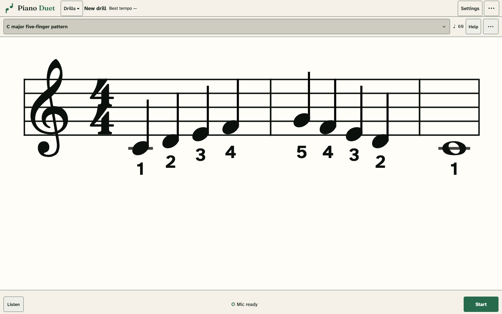
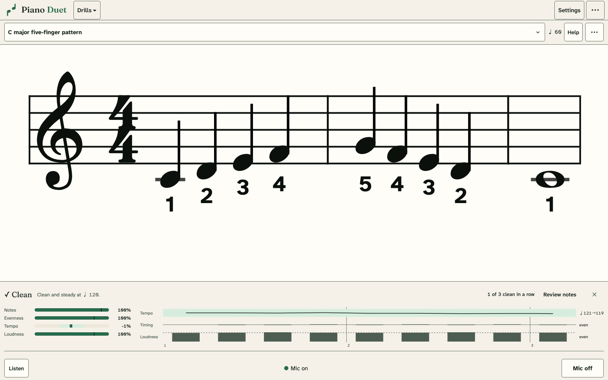

**Drills** is for mechanics: the technical work that the ABRSM, RCM and Trinity syllabi, Hanon, and common teaching methods agree on. The bar at the top shows the drill, its level, its tempo, **▶** (hear it played, highlighting each note), the beat, the last take, next drill, **Session** and instructions. Click the drill's name to change the drill, type, key, hands, range, practice pattern or repeat count, or to **Choose for me**. Every option has a **Random** choice. **Each take** is either **Build** (the same drill every take; **⏭** rolls a new one) or **Mix** (Random choices re-rolled every take).

- **Scales:** five-finger patterns; major, natural, harmonic and melodic minor scales over 1–4 octaves (hands separately, an octave apart, in contrary motion from a shared tonic, a third (tenth) apart, or a sixth apart); and the chromatic scale.
- **Arpeggios:** major and minor in all three positions, plus dominant and diminished sevenths.
- **Chords:** broken triads in triplets, solid triads through their inversions, and an I–IV–V⁷–I cadence (harmonic minor in minor keys).
- **Patterns:** Hanon No. 1.

Standard fingering is printed for scales, five-finger patterns, chords and Hanon. Minor scales on black-key tonics and the arpeggios show no fingering, because published editions disagree.

## Takes

Each take is one run-through of the drill as written, start to finish. Press **Space** once to turn on the microphone, then just play: a take ends by itself shortly after you stop (or press **Space**), your stats appear, and the next take is ready. The end is detected from your key presses, not from the room falling quiet, so a final note left ringing or background noise cannot hold a take open. Once every note of the drill has been heard, a gap of a little more than your own note spacing ends the take (at least 0.4 s); with most of them heard, twice your spacing (at least 0.8 s), so a hesitation near the end is not cut off. If the counter misses notes, the take still ends after 1.5 s of quiet. Each drill take also saves what the counter heard (its attack times and loudness, the noise floor, and why the take ended), so a take that ends late can be explained. Room sound with no piano attack for six seconds is dropped rather than scored, and nothing is recorded while the app's own piano or metronome is sounding. Starting to play again hides the stats; **Last** brings them back. The score follows playback and follows you while you play: the browser counts your attacks by spectral flux (energy appearing at new frequencies every 10 ms), scaled to how loudly you have been playing over the last few seconds, so it moves at your own pace and soft playing or a quiet microphone counts as reliably as loud playing. Notes themselves are recognized after the take.

## Results

Instead of a transcription of what you played, each take shows a compact panel. On the left, a meter for each measure fills from 0 to 100 with a tick at what a clean take needs, green when it is met and amber when not: notes, evenness (onsets against your own steady tempo), loudness evenness, and, where they apply, how close together the hands landed and how well accents stood out. Tempo and thumb crossings are centred meters, with a shaded band for what a clean take allows. On the right, a note-by-note timeline of the take, with bar numbers, shows the tempo you held as a line that turns amber where it leaves the band around your opening tempo, each note's timing (late notes rise in orange, early ones dip in blue, a red ✕ marks a missed note), and each note's loudness against your typical note, with notes much louder or softer than the rest in amber. Hover over a note for its bar, pitch, timing, tempo and loudness. The list below it names what happened, for example "Pause before B♭4 in bar 2: 360 ms late", "Played E4 + G4 + B4 first, then corrected it to E4 + G4 + C5", "Caught B4 beside C5" or "Played C4 twice". **Review notes** opens the heard notes, where a misheard take can be excluded.

Drill takes are transcribed by **Transkun 2.0** rather than the live model. On benchmark audio band-limited to the microphone's 16 kHz, it found 99% of the notes that sound together in chords with essentially no extras, while the live model at its 0.80 threshold found 83–85%. Lowering that threshold to 0.5 raised chord recall to 93% but added 8–9% stray notes. A 20-second take takes one to two seconds to transcribe. Reading and Library still use the live model, because they follow you note by note.

## Steadiness, levels and sessions

**Steadiness, not a forced tempo.** Drills train mechanics, so each take is judged against your own tempo, not a target. A take is clean with at least 90% of notes, 80% even timing (each gap measured against the tempo of its neighbouring gaps, so a slow drift is not double-counted as unevenness), no pause longer than the larger of 120 ms or 35% of the expected gap, and no drift of more than 8% between its first and last thirds. Changes under about 5% are hard to hear, which is where those tolerances come from. The tempo you played is measured and credited at the nearest metronome mark at or below it, allowing 3% for measurement wobble. Three clean takes in a row earn the slowest tempo among them as your **steady tempo** for that drill, key, hand and range. The bar then suggests the next metronome mark; two unclean takes in a row lower the suggestion. The suggestion sets the notation and the count-in, and **−/+** or **←/→** change it, but it never fails a take: play faster or slower and you are credited for what you played. The ladder of marks runs from quarter notes through eighths to sixteenths. Milestones are the RCM 2022 minimum tempos for the drill family; the syllabus also specifies octaves and hands. Dotted long–short and short–long rhythms, and accents every third or fourth note, are practice variations from Graham Fitch and Piano Marvel. They are scored against their pattern, relative to your own pulse, but only even playing earns a steady tempo. Staccato, pedalling and fingering cannot be heard reliably, so they are not graded.

**Levels.** Every drill has ten levels, shown in the bar and in **Drill levels** (click the level). A key counts once it has three clean takes in a row, credited at the slowest of them. Level 1 needs one key at the starting tempo. Each later level needs more keys (2, 3, 4, 6, 8, 10, 12, 16, then 20) at an evenly rising share of the drill's tempo ladder, and from level 4 hands together where the drill allows it. Each card shows what the next level needs and has a **Train** button. Level-ups get a banner, and the board shows your daily streak. Progress is replayed from your saved takes, so a rule change re-credits practice without rewriting it.

**Sessions.** **Session** asks only how long: 5–30 minutes, or 10 or 20 takes. The coach splits the time into at most three blocks of at least five minutes (or five takes). Each block works on one drill: the weakest by level, with drills you have not touched for a few days rising up the list, and not one already worked on this session. Within the drill it picks the key, hands and range that would earn the next level, resuming a key already under way before opening a new one. The block stays on that drill even if another becomes the weakest part-way through, so the time goes into improving one thing. The bar shows the block and the time left; at the end a summary lists level and tempo changes. Harder drill families (chromatic, arpeggios, cadence and Hanon, then seventh arpeggios) open as your drill levels grow. **Choose for me** uses the same coach for a single pick. Drill attempts feed the shared technique skills, including arpeggio and finger-pattern skills.
