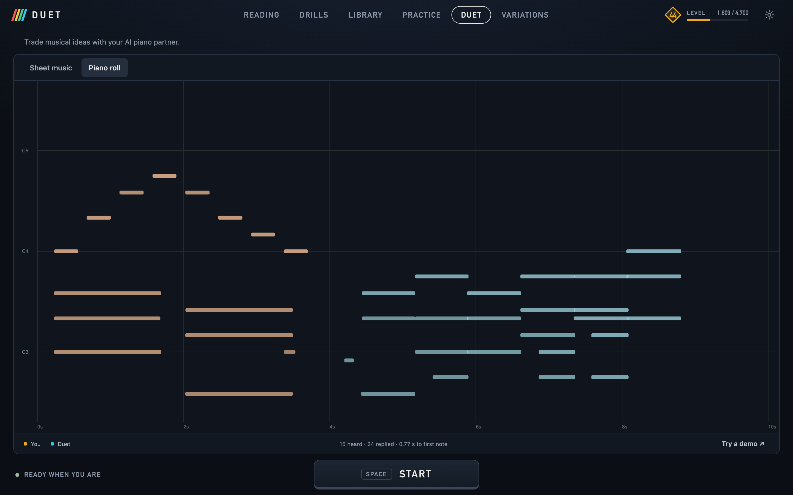

**Duet** continues the conversation as before. **Variations** (the original learning mode) follows a single practice cycle:

1. Play an idea, then pause or press **Answer now**.
2. Hear your practice target: the same phrase with model-suggested pitch corrections.
3. Play the target back. **Hear target again** replays it before your attempt.
4. Receive a score out of 100. Your next phrase starts a new learning round.

## Playing together

- Your turn has no fixed time limit. **Reply after a pause** is on by default in Duet and Variations, and off in Guided practice; **Leave a pause** controls the silence wait. Turn automatic replies off to play through rests, then use **Answer now**, **Finish attempt**, or **Space** when finished. Long performances take longer to transcribe and use more memory; transcription progress appears in the status. The full performance is transcribed and displayed, while Aria conditions on the most recent 180 notes.
- The microphone is excluded from inference during the AI's turn, followed by a 0.75-second speaker-decay guard. You can use speakers; headphones reduce room echo further. Simultaneous accompaniment is not implemented.
- **Reply length** sets a 2–12 second target. Aria receives its trained ending cue and can continue a few seconds to reach a resolution or a clear pause. Complete chords and final note durations are preserved. A short ending buffer chooses a musical boundary if the model keeps going. Sustained piano resonance may keep an input phrase open: use Space, release the sustain pedal, or raise **Noise gate**.
- **Reply difficulty** runs from **1 · Gentle** to **5 · Expert**, defaulting to **3 · Moderate**. Lower levels restrict attack speed, notes per chord and per hand, register, hand span, and jumps between hand positions. Gentle allows one note per hand per attack; Expert allows up to eight notes per attack. Higher levels allow complexity without requiring it. These are approximate playability controls, not formal piano grades: hand assignment is based on middle C, and fingering is not inferred. Difficulty constrains pitch, onset, and duration tokens before sampling; it does not delete notes afterward or change your playing. Changes apply to the next reply.
- Generated notes have a tempo-dependent minimum duration of 60–100 ms. Repeated short-note loops trigger the ending cue and longer articulation, and the same pitch cannot retrigger within 60 ms. These sampling constraints do not edit the notes you played.

- **Adventurousness** changes sampling temperature. Aria conditions on the recent conversation (up to 180 notes); it is primarily a piano continuation model, so replies may echo or repeat your phrase. Music quality depends on the input and is not guaranteed.

## Following your key

The app estimates a major or natural-minor key from your recognized notes and restricts Aria's pitch tokens to that scale **before sampling**. Your own notes remain unchanged, including chromatic notes. The current estimate and the seven allowed notes appear under **Key of your latest phrase**. Sparse or ambiguous evidence is marked **tentative**, but replies still follow the estimated scale.

Key detection uses duration- and velocity-weighted pitch classes, tonal profiles, and scale fit from **only the latest phrase you played**. It recalculates immediately for each reply. Earlier phrases and AI replies never count as key evidence. Musical conversation history can still influence the continuation, within the latest phrase's scale.

Major and relative minor can be ambiguous, and transcription mistakes can affect the estimate. Minor replies use natural minor: raised sixths and sevenths are excluded by the strict scale constraint. The detector currently does not identify other modes or atonal playing. Key tracking adds no model and runs locally.

## Variations scoring

Learning computes **surprise = 1 − P(played pitch | original preceding notes)** from Aria's actual logits. At each note, it sums the probabilities of that pitch's velocity tokens and normalizes over the 88 piano pitches. It uses temperature 1 without sampling, top-k filtering, key masks, or difficulty constraints. When surprise exceeds **Correct above surprise** (98% by default), it substitutes the most probable pitch. A proposed substitution that would duplicate another pitch in the same chord is kept unchanged and marked **chord overlap**. The note-by-note table shows every probability, surprise, expected pitch, and correction.

The model consumes your original notes one at a time with a cached causal prefix; corrections are never fed back as evidence for later predictions. It uses Aria's pitch/velocity → onset → duration token order, so pitch surprise is conditional on earlier note tokens rather than on the current note's exact onset. After the context fills, scoring retains recent original notes in a rolling context of at most 512 notes; every note in a long performance is still scored. The first notes have little musical context. High surprise means unexpected to this model, not objectively incorrect music.

Corrections preserve recognized onset times, durations, velocities, and phrase length, removing only leading silence for playback. The target is stored in memory until the attempt is scored or a new idea replaces it. Your idea, target, and playback appear as separate sheet-music phrases. Changing modes starts a fresh conversation.

Playback scoring aligns attacks and chords in order, allowing missing and extra attacks. Pitch accuracy is the harmonic mean of note precision and recall. The overall score is pitch accuracy multiplied by an 80% pitch / 20% relative-rhythm factor. Rhythm uses matched attack intervals after compensating for one consistent tempo change; timing deviations within 60 ms are tolerated, with larger errors reducing the rhythm score smoothly. Initial recording delay and chord ordering do not count against you. The breakdown includes matched, wrong, missing, and extra notes. Durations and velocities are not graded. Scores depend on microphone transcription accuracy; a recording with no recognized notes asks for another attempt instead of scoring silence.

## The conversation as music

**Sheet music** displays the full conversation as separate **You** and **Duet** phrases on treble and bass staves, including chords, rests, ties, and accidentals. The newest phrase scrolls into view, and the view follows the highlighted reply during playback. **Piano roll** shows the latest exchange with its original timing.

Transcribed performance rhythms are approximate: notes snap to a sixteenth-note grid, with nearby attacks grouped into chords. Tempo is estimated per exchange; **Set BPM** overrides it. Meter defaults to 4/4, with 3/4 and 6/8 available. The key signature follows the detected key. **Spelling** chooses sharps or flats for chromatic notes; scale notes use the key's spelling. These controls never change audio or exported MIDI. Transcription splits notes around middle C and does not infer fingering, triplets, or an original score. **Reading targets** instead preserve their exact written onsets, rests, explicit hand assignments and eighth-note triplets on a twelve-tick quarter-note grid. They support 2/4, 3/4, 4/4, 5/4, 6/8, 7/8, 9/8 and 12/8.
