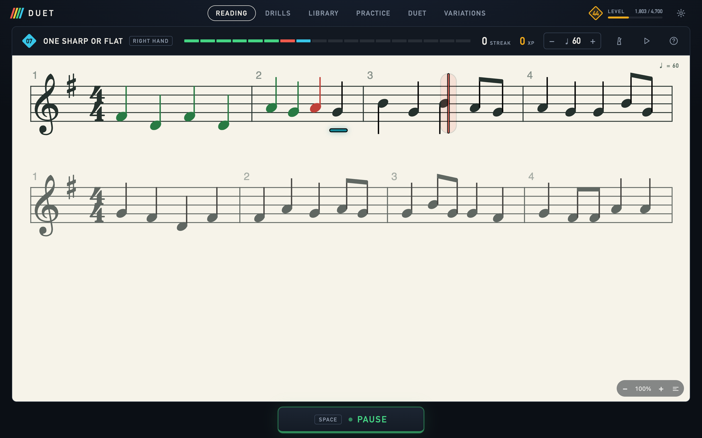

**Reading mode** progresses from first notes to advanced piano scores. Enable the microphone and play the highlighted note or chord. Correct notes turn green and advance the cursor. A wrong press appears in red beside the expected notes; the cursor waits for correction. A held note counts once, and repeated written notes require separate attacks. The score follows you, keeping the music ahead in view; the score you just finished stays faded above, and the next one is already waiting below. Upcoming scores are prepared in advance and stay unchanged once shown; completed attempts save in the background without restarting microphone recognition. Early stages use a single staff; later stages use the grand staff. Your selected mode is remembered in this browser.

Recognition details are in [How Piano Duet listens](/how/listening/).

## The curriculum

The reading curriculum has **24 stages**. Every score is four bars long, two bars per line at the default size. Each score moves the hand to a new position at least once; other bars stay put about two times in three. A numbered finger marks each landing in the early stages. Rests have no standalone stage: early phrases keep moving, while occasional rests enter with ties and offbeats in later music. In alternating-clef scores, the inactive hand still shows its written rests.

- **1–6, Beginner:** first notes, steps and skips, fourths, fifths, long notes, eighth notes.
- **7–11, Developing:** one sharp or flat, minor melodies and raised leading notes, dyads, alternating clefs, hands together over held bass.
- **12–17, Intermediate:** dotted rhythms, triads and inversions, ties and offbeats, compound time, ledger lines, signatures with up to four sharps or flats.
- **18–23, Advanced:** sixteenths, triplets, independent hands, all 24 major/minor keys, additional meters, seventh chords and octave shapes.
- **24, Expert practice:** four-bar scores integrating the preceding material, with changing registers and a higher comfortable pace. This describes the generated material, not an exam qualification or a claim to assess every aspect of expert performance.

Stages 1–11 need three recent fresh unaided scores per relevant hand, stages 12–17 need four, and stages 18–24 need six (grand-staff stages use one combined group). Those recent scores must average at least 90% pitch accuracy and, from stage 5, have measurable rhythm averaging at least 80%. A hand that already meets its requirements is not assigned extra scores just to balance attempt counts. Long-note exercises vary the placement and combinations of quarter, half and whole notes, avoid the last four completed rhythm patterns, and always contain enough intervals to assess. Minimum quarter-note tempos begin at 44 BPM in stage 12 and rise gradually to 72 BPM at stage 24. Signature-introduction stages add one accidental at a time, waiting for successful examples in the simpler signatures before expanding, and require successful examples in every introduced key; other multi-key stages require three keys. Stage 22 requires all six of its meters. The first two stages also establish each foundation note with at least three readings and 85% recent accuracy. Completed stages stay earned; explicitly excluding their evidence recalculates the path. Historical white-key reading can establish the first two stages but cannot award unplayed advanced stages. Curriculum progress is recalculated from saved performances, so corrected rhythm rules also credit existing practice without rewriting recordings or assessments.

The scores themselves are written by Aria under the curriculum's rules: see [Constrained decoding](/how/constrained-decoding/).

## Holding notes and timing

From stage 5, a **hold/rest count** above the staff follows the displayed tempo. The highlight stays on the recognized note through its written duration, follows ties and rests, and waits through the final note and trailing rests before finishing the score. A final whole note in 4/4 gets four quarter-note beats. The clock starts at the detected onset, so recognition latency does not add extra holding time, and pauses with microphone capture. Early or late subsequent presses are still recorded at their actual times for rhythm assessment. This is a visual timing guide, not a measurement of when a physical key is released. Fingering stays inside filled noteheads and appears above hollow notes so their duration remains legible.

## Scoring

Reading scores measure **first-try pitch accuracy**. Corrections remain in the history and inform which pitches need practice; eventually completing every note does not turn a mistaken first try into 100%. From stage 5, **rhythm accuracy** measures spacing between attacks, including written rests, relative to the player's median pace. Through stage 11 it measures rhythm within each hand position, keeping the time to find a new position separate; two usable intervals are enough for a short score. From stage 12 it also measures continuity across position changes and requires three usable intervals. Both require 75% timing coverage; corrections, interruptions, gaps over ten seconds and uncertain detections do not supply timing evidence. An 80 ms tolerance accommodates recognition jitter. Note releases, pedaling, expression and fingering are not graded. **Position-change fluency** remains a separate metric and never directly gates curriculum advancement. History uses a short placeholder duration for onset events, and these attempts are not offered as repertoire pieces. Click the XP card that appears after each score, or a bar under **Progress → Recent scores**, to review the assessment and exclude a misheard attempt. Hearing the score or opening a hint marks it as assisted. Stopping the microphone pauses your place.

An attack containing every expected pitch plus only octave duplicates is accepted, avoiding a penalty when the transcriber hears piano overtones as an octave. Every written pitch must be present: a lone note in the wrong octave, an incomplete chord or an unrelated extra tone still waits for correction. All recognized pitches remain in the saved history.

## Progress, XP and replay

**Progress** (the level badge) shows your reader level and XP, the 24-stage path, the current stage's goals per hand, recent scores, and the three reading skills. The bar above the music shows the stage, hand, note progress, your first-try streak and the XP earned this session. The metronome button (**Hear the beat**) follows the current meter, including compound pulses and 2+2+3 grouping in 7/8. **▶** in the bar above the music plays the score at your chosen tempo, highlighting each note as it sounds; press it again to stop without turning off the microphone. **?** explains finger numbers and offers the same playback. Numbered first notes guide early five-finger positions; from the key-signature stages, fingering is the player's choice. Every active hand changes position between its bars. **See all piano skills** opens the shared profile.

**XP and levels** reward reading without changing assessment. Each fresh score awards XP per first-try note (10 at stage 1, rising by 2 per stage), a quarter of that per corrected note, half of it per attack in your longest first-try streak of at least four, a rhythm bonus of half the note XP scaled by rhythm accuracy, and a 50% **Perfect read** bonus. A note introduction awards three notes' worth. Hearing the score or opening a hint halves the score's XP. Clearing a stage adds 300 XP plus 100 per stage number. Level 1 needs 400 XP, and each level needs 100 more than the last. XP is recalculated from saved live reading, so excluding an attempt removes its XP; levels are a reward for practice, separate from the skill-gated stages.

**Replay** any cleared stage from **Progress → Stage path**: select it and choose **Replay stage N**. The bar above the music shows **Replay ✕**; click it, or **Back to current** in the path, to return. Replayed scores are saved as evidence for the replayed stage and earn that stage's XP; your current stage is unchanged. On rhythm stages, **−/+** or **←/→** set the playing tempo in 4 BPM steps. It drives only the pace guide, hold count and **Hear the beat**, never the grade, and cannot go below a stage's minimum tempo.

When a note first enters the foundation stages, a short **Meet this note** introduction names it and explains its staff position. Introductions are saved as practice with the answer shown; they do not raise reading ratings. Subsequent fresh exercises test the note without its name.

## Position changes and fluency

Fluency uses audio onset times, not recognition response times. The preceding four correct notes establish the median seconds per beat; the landing is compared with its written spacing at that pace. All five attacks need confidence of at least 0.8, and the reference intervals must stay within 25% of the median (or 80 ms). Microphone/audio interruptions, opening a panel during the transition, corrections, assisted practice and unstable reference bars leave the change untimed. A landing more than 25% early is ungraded; a gap longer than the greater of six seconds or four expected gaps, capped at ten seconds, is treated as an ambiguous pause. These are conservative measurement defaults, not exam standards. Only the transition inside the row is timed; the first note of a row has no within-row pace reference. Finger numbers describe the requested movement, not a verified finger choice.

**Progress → Position landings** includes treble and bass staff heat maps. Each destination pitch combines all suggested fingers and positions. Arrival time runs from the preceding attack to the first correct note after the change, including retries. Only those two detections and recording continuity between them determine whether the landing can be timed; uneven playing, mistakes, hints, and recognition quality elsewhere do not disqualify it. Note introductions remain unscored because they show the answer. Selecting a note shows its arrival time and sample count. Colors use a fixed 0.5–3 second arrival-time scale, so they include playing pace. One or two measurements have a faint color labeled “early estimate”; gray means no usable measurements. Saved onset observations are recalculated under the same rules without modifying raw attempts. Recordings without continuity information remain untimed.

Timing summaries use an exponential moving average with a five-change half-life. Per-note arrival estimates use the full accepted history; separate per-hand extra-pause summaries still require a steady, correct first bar and use up to 20 recent changes, with equal recent and preceding comparison windows after ten measurements. Before averaging or targeting slow transitions, gaps over ten seconds and isolated high-delay outliers are excluded. Arrival time and extra pause are filtered independently. With at least five observations of the same clef and pitch, a local window of up to 21 observations estimates a median and median absolute deviation; the upper cutoff is the median plus the larger of 1.5 seconds or four robust standard deviations. Adjacent slow observations are retained so sustained difficulty is not discarded. Raw attempts remain reviewable. Each event retains the destination note, suggested finger and signed hand-position distance. Three clean observations of a transition are required before its repeated hesitation increases its sampling weight. Small changes are favored until both varied pitch accuracy and fluency are established, then larger shifts become more frequent. Excluding or restoring an attempt recalculates the heat map, summaries, and practice targets.
